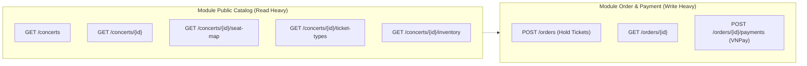
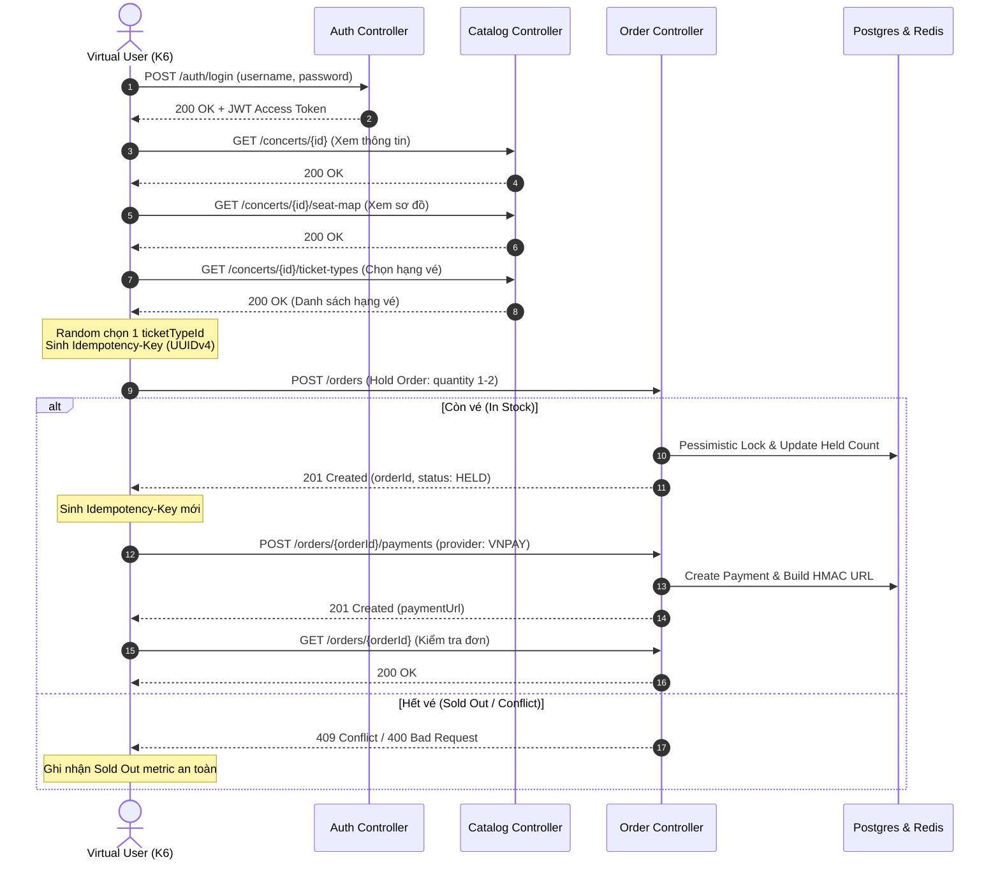

# Kế hoạch Kiểm thử Hiệu năng (Load Testing Plan)
## Module Public Catalog & Order - TicketBox Platform

---

## 1. Tổng quan & Mục tiêu (Executive Summary)

### 1.1. Bối cảnh
TicketBox là nền tảng bán vé trực tuyến phục vụ các sự kiện âm nhạc và giải trí quy mô lớn. Trong các sự kiện mở bán vé có lượng quan tâm cao (Flash Sale / Hot Events), hệ thống phải tiếp nhận hàng chục nghìn lượt truy cập đồng thời, dồn dập gửi yêu cầu xem thông tin, giữ chỗ và thanh toán trong một khoảng thời gian rất ngắn.

### 1.2. Mục tiêu kiểm thử
- **Đo đạc thực tế các chỉ số phân vị độ trễ (Latency Percentiles)**: Thu thập chính xác **P50 (Median), P95 và P99** của từng API độc lập và của toàn bộ luồng nghiệp vụ E2E khi hệ thống vận hành dưới tải cao.
- **Xác định thông lượng tối đa (Max Throughput - RPS)**: Khảo sát số lượng yêu cầu mỗi giây mà hệ thống có thể xử lý ổn định trước khi phát sinh lỗi hoặc suy giảm hiệu năng nghiêm trọng.
- **Phát hiện các điểm nghẽn (Bottlenecks)**:
  - Khả năng chịu tải và thời gian chờ khóa hàng ghế/loại vé (Pessimistic Lock / Redis Lock Contention).
  - Khả năng đáp ứng của HikariCP Connection Pool trong Spring Boot và PostgreSQL.
  - Hiệu quả của cơ chế Caching và SingleFlight trong module Public Catalog.
  - Mức độ tiêu thụ CPU, RAM và Garbage Collection của JVM dưới áp lực 1.000 VUs.
- **Nguyên tắc kiểm thử**:
  - **Thuần đo đạc (Exploratory Benchmarking)**: Không đặt ngưỡng cứng (pass/fail thresholds) làm dừng bài test sớm; tập trung ghi nhận bức tranh thực tế về năng lực hệ thống để làm cơ sở tối ưu hóa kiến trúc.

---

## 2. Phạm vi Kiểm thử (Testing Scope)

Kiểm thử tập trung vào 2 module chịu tải lớn nhất của hệ thống: **Public Catalog** (đọc nhiều - Read-Heavy) và **Order & Payment Request** (ghi cạnh tranh cao - Write-Heavy/Lock Contention).



### 2.1. Danh sách API trong phạm vi

| Module | Phương thức | Endpoint | Yêu cầu Auth | Mô tả nghiệp vụ |
| :--- | :--- | :--- | :---: | :--- |
| **Catalog** | `GET` | `/concerts` | Không | Tìm kiếm, lọc và phân trang danh sách sự kiện |
| **Catalog** | `GET` | `/concerts/{concertId}` | Không | Xem chi tiết thông tin sự kiện (nghệ sĩ, địa điểm, thời gian) |
| **Catalog** | `GET` | `/concerts/{concertId}/seat-map` | Không | Tải sơ đồ khu vực khán đài / chỗ ngồi |
| **Catalog** | `GET` | `/concerts/{concertId}/ticket-types` | Không | Danh sách các hạng vé, giá niêm yết và trạng thái bán |
| **Catalog** | `GET` | `/concerts/{concertId}/inventory` | Không | Tồn kho vé theo thời gian thực |
| **Catalog** | `GET` | `/concerts/{concertId}/quota` | **Có** | Hạn mức mua vé còn lại của tài khoản |
| **Order** | `POST` | `/orders` | **Có** | Giữ vé (Hold Order) kèm `Idempotency-Key` (UUIDv4) |
| **Order** | `GET` | `/orders/{orderId}` | **Có** | Truy vấn trạng thái đơn hàng |
| **Order** | `POST` | `/orders/{orderId}/payments` | **Có** | Tạo yêu cầu thanh toán VNPay kèm `Idempotency-Key` |

### 2.2. Ngoài phạm vi (Out of Scope)
- Các API quản trị Admin (`/admin/**`), tạo/sửa sự kiện, cấu hình vé.
- Module Artist Bio AI generation (`/artists/**/generate-bio`).
- Webhook / IPN callback từ cổng thanh toán bên thứ ba (đây là luồng background asynchronous đã có test riêng).

---

## 3. Chiến lược Dữ liệu & Môi trường (Test Data Strategy)

### 3.1. Dữ liệu Người dùng (10.000 Test Users)
- **Tạo tài khoản & Mật khẩu đồng bộ**:
  - Sinh 10.000 người dùng hợp lệ với định dạng email: `loadtest_user_00001@ticketbox.test` đến `loadtest_user_10000@ticketbox.test`.
  - Mật khẩu thống nhất: `Password@123` (được băm bằng BCrypt sẵn trong DB để tiết kiệm chi phí CPU lúc seed).
  - Quyền hạn: Role `AUDIENCE`.
- **Cơ chế nạp dữ liệu vào K6 via `SharedArray`**:
  - Dữ liệu 10.000 user được xuất ra file `k6/performance-testing/data/users.json`.
  - K6 chạy bằng kiến trúc đa luồng JavaScript runtime. Nếu nạp thông thường qua `JSON.parse(open(...))`, mỗi VU sẽ sao chép toàn bộ 10k users vào bộ nhớ riêng, gây lãng phí hàng trăm MB/GB RAM và dẫn tới tràn bộ nhớ (Out-Of-Memory).
  - Sử dụng module `k6/data` với `new SharedArray('users', () => JSON.parse(open('...')))`: dữ liệu chỉ nạp vào RAM một lần duy nhất ở dạng read-only memory buffer và chia sẻ an toàn cho toàn bộ 1.000 VUs.
  - Phân bổ tài khoản cho từng VU bằng công thức:
    $$\text{User Index} = (\_\_VU - 1) \pmod{\text{totalUsers}}$$

### 3.2. Dữ liệu Sự kiện & Tồn kho Vé (Flash Sale Hotspot)
- Khởi tạo 1 sự kiện mẫu đặc biệt: **"Mega Concert 2026 - Flash Sale Contention"**.
- Cấu hình đa dạng hạng vé (Ticket Types) với số lượng tồn kho giới hạn nhằm mô phỏng sát thực tế:
  1. `VIP Lounge`: 200 vé
  2. `Zone A (Standing)`: 1.000 vé
  3. `Zone B (Seated)`: 2.000 vé
  4. `Standard (CAT 1)`: 3.000 vé
  5. `Early Bird`: 500 vé
- **Cơ chế phân tán lựa chọn**: Trong kịch bản E2E, các VU sẽ ngẫu nhiên chọn 1 trong các hạng vé trên để gửi yêu cầu giữ vé, tránh việc 100% VUs chỉ chọn đúng 1 hạng vé duy nhất nhưng vẫn đảm bảo toàn bộ 1.000 VUs tập trung vào 1 sự kiện duy nhất.

---

## 4. Thiết kế Kịch bản Kiểm thử (Test Scenarios)

Kế hoạch kiểm thử được chia thành 2 phần kế tiếp nhau:

```
[Phần 1: Kiểm thử Độc lập từng API]
    ├── Catalog Public APIs (Concerts, Detail, Seat Map, Inventory)
    └── Order APIs (Hold Order, Order Detail, Payment Request)
         │
         ▼
[Phần 2: Kiểm thử Luồng Tích hợp E2E Flash Sale]
    └── Login -> View Details -> Hold Order -> Create Payment
```

---

### 4.1. Phần 1: Kiểm thử Độc lập Từng API (Isolated API Benchmarking)

Mục đích: Xác định đường cong độ trễ (P50, P95, P99) và ngưỡng bão hòa của từng endpoint khi tách biệt khỏi các tương tác phức tạp khác.

#### Kịch bản tải độc lập cho từng API:
- **Thời lượng**: 3.5 phút/endpoint.
- **Ramp-up**: 0 -> 100 VUs (30s).
- **Ramp-up 2**: 100 -> 300 VUs (1 phút).
- **Steady Peak**: Duy trì 300 VUs (1.5 phút) để đo đạc chỉ số ổn định.
- **Ramp-down**: 300 -> 0 VUs (30s).

#### Bảng cấu hình kiểm thử các API:

| Nhóm API | Endpoint | Payload / Params | Mục đích khảo sát |
| :--- | :--- | :--- | :--- |
| **Catalog Listing** | `GET /concerts?page=0&size=20` | Query params tìm kiếm, phân trang | Đo hiệu năng Index PostgreSQL & Serialization JSON |
| **Concert Detail** | `GET /concerts/{concertId}` | UUID của Flash Sale concert | Đo hiệu năng Cache Redis & SingleFlight |
| **Seat Map** | `GET /concerts/{concertId}/seat-map` | UUID của Flash Sale concert | Đo dung lượng payload lớn & gzip/transfer rate |
| **Ticket Types** | `GET /concerts/{concertId}/ticket-types` | UUID của Flash Sale concert | Đo độ trễ query bảng loại vé |
| **Inventory** | `GET /concerts/{concertId}/inventory` | UUID của Flash Sale concert | Đo độ trễ truy vấn tồn kho thời gian thực |
| **Hold Order** | `POST /orders` | JSON: `concertId`, `ticketTypeId`, `quantity: 1..2`, Header `Idempotency-Key` | Đo áp lực tranh chấp khóa bi quan (Pessimistic Lock) |
| **Create Payment** | `POST /orders/{orderId}/payments` | JSON: `provider: "VNPAY"`, `bankCode: "NCB"`, Header `Idempotency-Key` | Đo hiệu năng sinh URL ký HMAC SHA-512 tại chỗ |

---

### 4.2. Phần 2: Kiểm thử Luồng Tích hợp E2E (Flash Sale Composite Journey)

Mô phỏng hành vi thực tế của người dùng khi sự kiện chính thức mở bán. 1.000 VUs đồng thời thực hiện tuần tự các bước trong một User Session.

#### Lưu đồ hành vi của mỗi VU trong một Iteration:



#### 4.2.2. Hồ sơ Tải K6: Mô hình Đột biến Đầu giờ (Front-loaded Burst / Spike Profile - 5 phút)

Trong thực tế mở bán sự kiện Flash Sale (ví dụ quy mô 80.000 lượt truy cập trong 5 phút đầu), hành vi người dùng **không tăng dần từ từ** mà **dồn dập ngay từ giây đầu tiên** khi hệ thống mở cổng:
- **Phút thứ nhất (0:00 - 1:00)**: Chiếm **70% tổng lưu lượng** (~56.000 lượt truy cập), tạo ra một đợt Spike cực lớn với hàng nghìn user gửi yêu cầu cùng lúc.
- **Phút thứ 2 đến 5 (1:00 - 5:00)**: Chiếm **30% lưu lượng còn lại** (~24.000 lượt truy cập, trung bình 6.000 lượt/phút), phân bổ đều đặn cho những người vào sau hoặc thử lại (retry).

##### Cấu hình Stages chi tiết (Ramping VUs - 1.000 Peak VUs):
1. **Stage 1 (Spike tức thì)**: `0s -> 15s` vút thẳng từ 0 lên đỉnh **1.000 VUs** (mô phỏng cổng bán vé mở, người dùng ùa vào lập tức).
2. **Stage 2 (Duy trì 70% tải đỉnh)**: `15s -> 1m00s` (45 giây) giữ liên tục ở mức **1.000 VUs** với pacing ngắn (100 - 300ms) để dồn 70% tổng số giao dịch vào phút đầu tiên.
3. **Stage 3 (Hạ tải về nhóm còn lại)**: `1m00s -> 1m15s` (15 giây) giảm tải từ 1.000 VUs xuống **300 VUs** (tương ứng mức 30% lưu lượng).
4. **Stage 4 (Duy trì 30% tải trong 4 phút sau)**: `1m15s -> 5m00s` (3 phút 45 giây) duy trì đều ở mức **300 VUs**.
5. **Stage 5 (Hạ nhiệt)**: `5m00s -> 5m15s` giảm từ 300 về 0 VUs, hoàn tất phiên test 5 phút.

```
VUs
1000 |  ┌───────────────────────┐ (Phút 1: 70% tải - Rush)
     |  │                       │
 500 |  │                       │
 300 |  │                       └────┬─────────────────────────────┐ (Phút 2-5: 30% tải)
     |  │                                                      │
   0 └──┴──────────────────────────────────────────────────────┴────
       0s  15s                 1m                             5m    Time
```

##### Cấu hình mẫu qua `ramping-arrival-rate` (Đo Throughput tuyệt đối):
Nếu muốn kiểm soát chính xác số lượng request/giây theo đúng tỷ lệ 80.000 users trong 5 phút:
- Phút 1 (60s): 56.000 requests / 60s $\approx$ **933 requests/giây**.
- Phút 2 - 5 (240s): 24.000 requests / 240s $\approx$ **100 requests/giây**.
Kịch bản K6 hỗ trợ linh hoạt chuyển đổi giữa `ramping-vus` (khảo sát năng lực xử lý đồng thời) và `ramping-arrival-rate` (ép tải cố định theo chỉ tiêu RPS).


---

## 5. Đo đạc & Thu thập Chỉ số (Metrics & Observability)

### 5.1. Các chỉ số K6 cốt lõi
Hệ thống K6 sẽ tự động tính toán và báo cáo các chỉ số phân vị sau:

- **`http_req_duration`**:
  - `p(50)` (Median): 50% số lượng request có thời gian phản hồi nhỏ hơn giá trị này (thước đo trải nghiệm người dùng điển hình).
  - `p(95)`: 95% số request có thời gian phản hồi nhỏ hơn giá trị này (đo lường nhóm người dùng bị ảnh hưởng bởi độ trễ cao).
  - `p(99)`: 99% số request có thời gian phản hồi nhỏ hơn giá trị này (phản ánh các trường hợp biên, đuôi độ trễ do lock contention hoặc GC pause).
- **`http_req_failed`**: Tỷ lệ phần trăm các request không thành công.
  - *Lưu ý*: Với API giữ vé `POST /orders`, khi vé đã bán hết, hệ thống trả về mã lỗi nghiệp vụ (ví dụ `400` hoặc `409 Sold Out`). K6 script sẽ sử dụng Custom Check để phân biệt giữa **hết vé nghiệp vụ hợp lệ** và **lỗi sập hệ thống (500 Internal Server Error, 502/504 Gateway Timeout)**.
- **`http_reqs`**: Tổng số lượng request và Throughput (RPS).
- **`vus`**: Số lượng người dùng ảo đang thực thi tại từng thời điểm.

### 5.2. Custom Metrics (K6 Trend & Counter)
Để bóc tách chi tiết từng bước trong luồng E2E, kịch bản khai báo các metrics tùy chỉnh:

| Tên Metric | Kiểu K6 | Mô tả |
| :--- | :---: | :--- |
| `trend_login_duration` | `Trend` | Thời gian xử lý đăng nhập & cấp phát JWT token |
| `trend_catalog_detail_duration` | `Trend` | Thời gian đọc thông tin sự kiện & sơ đồ chỗ ngồi |
| `trend_order_hold_duration` | `Trend` | Thời gian giữ vé (đo lường trực tiếp thời gian giữ khóa DB) |
| `trend_payment_create_duration` | `Trend` | Thời gian tạo đơn thanh toán & sinh URL |
| `counter_orders_held_success` | `Counter` | Số đơn giữ vé thành công |
| `counter_orders_sold_out` | `Counter` | Số lần nhận phản hồi hết vé (400/409 hợp lệ) |
| `counter_system_errors` | `Counter` | Số lỗi hệ thống (5xx, Network Timeout) |

### 5.3. Giám sát Hạ tầng Backend song song
Trong quá trình K6 chạy tải, kỹ sư kiểm thử cần giám sát các thông số server:
1. **JVM (Spring Boot)**:
   - Tần suất và thời gian dừng của Garbage Collector (G1GC pauses).
   - Mức chiếm dụng Heap Memory.
   - Trạng thái HikariCP: `ActiveConnections`, `IdleConnections`, `PendingThreads` (nếu pending threads tăng cao -> DB pool là bottleneck).
2. **PostgreSQL**:
   - `pg_stat_activity`: Số lượng session đang `active` và câu lệnh đang chờ `exclusive lock` trên bảng `ticket_types` / `seat_zones`.
   - CPU utilization và Disk I/O.
3. **Redis**:
   - Tỷ lệ Cache Hit / Cache Miss đối với thông tin concert.
   - Thao tác khóa phân tán và Sliding Window Rate Limiting.

---

## 6. Kỹ thuật Triển khai & Biện pháp Chống Lỗi (Technical Blueprint)

### 6.1. Quản lý Idempotency-Key
- Các endpoint `POST /orders` và `POST /orders/{orderId}/payments` bắt buộc truyền header `Idempotency-Key` định dạng UUID version 4.
- Trong script K6, mỗi lượt tạo đơn / tạo thanh toán của VU sẽ tự động sinh một UUID v4 duy nhất (dùng thuật toán sinh UUID v4 chuẩn trong JS) để đảm bảo không bị từ chối bởi `RequestValidationException("INVALID_IDEMPOTENCY_KEY")`.

### 6.2. Cấu hình Cổng Thanh toán VNPay
- Chọn nhà cung cấp thanh toán `provider: "VNPAY"`.
- **Lý do**: Khác với MoMo (gọi HTTP API ra máy chủ MoMo bên ngoài), VNPay Gateway trong TicketBox thực hiện tạo tham số và ký số HMAC-SHA512 hoàn toàn **tại chỗ (in-process)**. Điều này giúp bài test đo đạc thuần túy năng lực xử lý của hệ thống TicketBox mà không bị nghẽn mạng bên ngoài hoặc bị Sandbox Gateway của đối tác chặn rate-limit.

### 6.3. Điều chỉnh Cấu hình Rate Limiting khi Chạy Test
- TicketBox được trang bị `RateLimitFilter` sử dụng Redis Sliding Window.
- Khi 1.000 VUs cùng xuất phát từ một máy kiểm thử (cùng địa chỉ IP), nếu không điều chỉnh chính sách, hệ thống sẽ trả về mã `429 Too Many Requests`.
- **Giải pháp**:
  - Tùy chỉnh cấu hình rate limit cho môi trường test (nâng hạn mức `OrderRateLimitPolicy` và `CatalogRateLimitPolicy` lên ngưỡng cao trong `application-test.yml` hoặc profile dành riêng cho load test).
  - Hoặc truyền header nhận diện máy test nội bộ nếu hệ thống có cơ chế whitelist.

---

## 7. Cấu trúc Tổ chức Thư mục & File Artifacts

Toàn bộ mã nguồn kiểm thử và dữ liệu được đóng gói trong thư mục `k6/performance-testing/`:

```text
k6/performance-testing/
├── testplan.md                                      # Tài liệu kế hoạch kiểm thử chi tiết (file này)
│
├── data/
│   ├── seed-users.sql                               # Script SQL tạo sẵn 10.000 user với BCrypt hash
│   ├── generate-data.js                             # Script Node.js sinh data và xuất users.json
│   └── users.json                                   # Danh sách 10.000 credentials phục vụ SharedArray
│
├── config/
│   └── environments.js                              # Cấu hình BASE_URL, Target Concert ID, Headers
│
├── scenarios/
│   ├── catalog-isolated.js                          # Kịch bản test độc lập từng API Public Catalog
│   ├── order-isolated.js                            # Kịch bản test độc lập API Order (Hold & Payment)
│   └── flash-sale-e2e.js                            # Kịch bản tích hợp E2E luồng mua vé Flash Sale (1000 VUs)
│
├── helpers/
│   ├── auth.js                                      # Helper login & cache bearer token
│   ├── uuid.js                                      # Helper sinh UUIDv4 cho Idempotency-Key
│   └── metrics.js                                   # Khai báo các Custom Trends và Counters
│
└── run-tests.sh                                     # Script điều khiển chạy tự động và xuất báo cáo
```

---

## 8. Hướng dẫn Thực thi & Đọc Kết quả (Execution Guide)

### 8.1. Các bước chuẩn bị môi trường
1. **Khởi động hạ tầng**:
   ```bash
   docker compose up -d
   ```
2. **Khởi chạy Backend với profile phù hợp**:
   ```bash
   cd backend
   ./mvnw spring-boot:run
   ```
3. **Sinh dữ liệu 10.000 người dùng**:
   ```bash
   # Chạy script sinh dữ liệu và nạp vào DB
   node k6/performance-testing/data/generate-data.js
   ```

### 8.2. Chạy kiểm thử với K6
- **Chạy bài test độc lập Catalog**:
  ```bash
  k6 run k6/performance-testing/scenarios/catalog-isolated.js
  ```
- **Chạy bài test độc lập Order**:
  ```bash
  k6 run k6/performance-testing/scenarios/order-isolated.js
  ```
- **Chạy bài test tổng thể E2E Flash Sale (1.000 VUs)**:
  ```bash
  k6 run --summary-export=summary-e2e.json k6/performance-testing/scenarios/flash-sale-e2e.js
  ```

### 8.3. Mẫu Bảng Báo Cáo Đo Đạc Kết Quả (Target Report Format)

Sau khi hoàn tất bài test, kết quả sẽ được tổng hợp theo biểu mẫu phân vị tiêu chuẩn:

| Endpoint / Nghiệp vụ | Tổng Request | RPS Trung bình | P50 (ms) | P95 (ms) | P99 (ms) | Tỷ lệ Lỗi (5xx) | Ghi chú / Điểm nghẽn |
| :--- | :---: | :---: | :---: | :---: | :---: | :---: | :--- |
| `GET /concerts` | - | - | - | - | - | -% | Đánh giá phân trang & cache |
| `GET /concerts/{id}` | - | - | - | - | - | -% | Đánh giá SingleFlight & Redis |
| `GET /concerts/{id}/seat-map` | - | - | - | - | - | -% | Đánh giá payload truyền tải |
| `GET /concerts/{id}/ticket-types`| - | - | - | - | - | -% | Đánh giá DB query |
| `POST /orders` (Hold Ticket) | - | - | - | - | - | -% | Áp lực Pessimistic Lock |
| `POST /orders/{id}/payments` | - | - | - | - | - | -% | Áp lực ký HMAC & lưu DB |
| **Toàn bộ luồng E2E** | - | - | - | - | - | -% | Trải nghiệm người dùng tổng thể |
